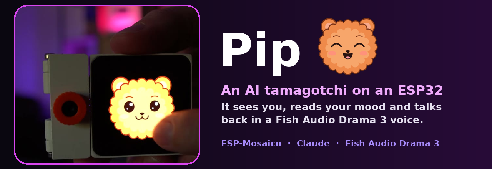
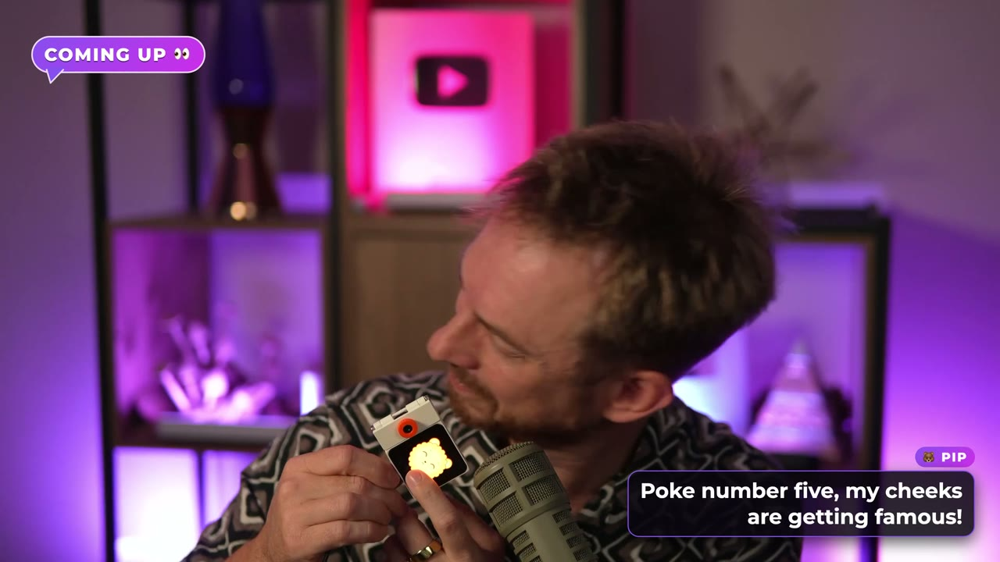
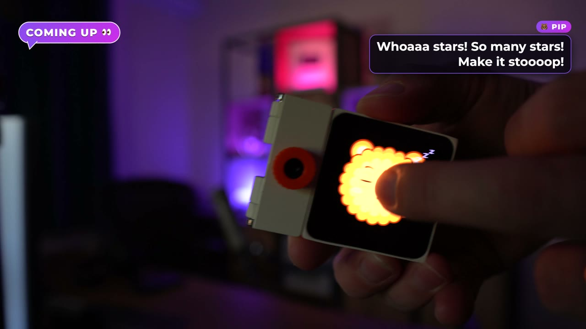
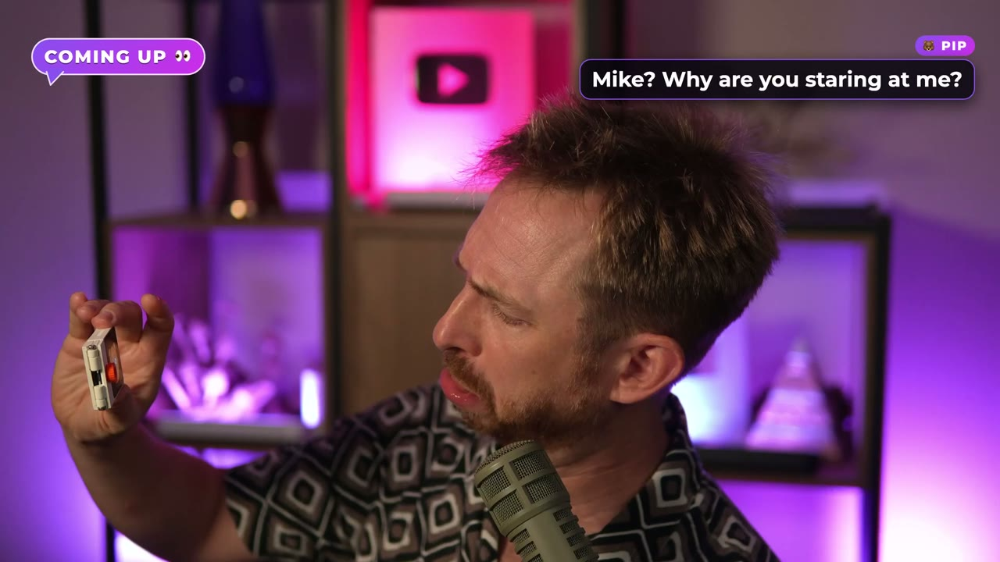
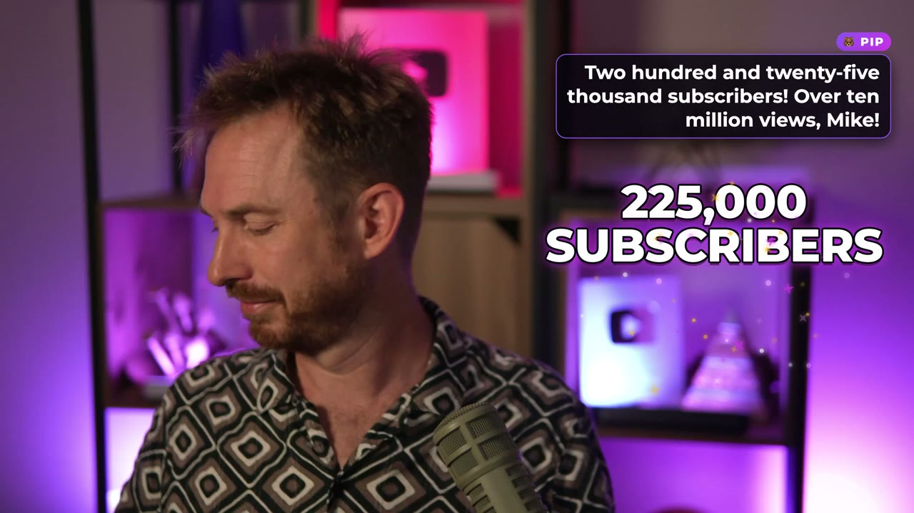
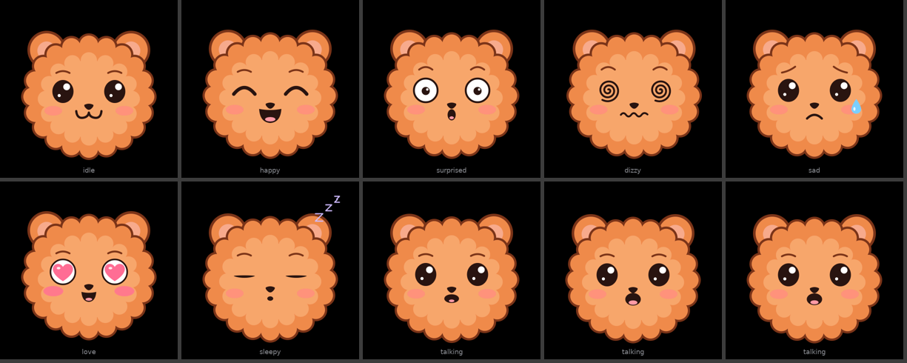
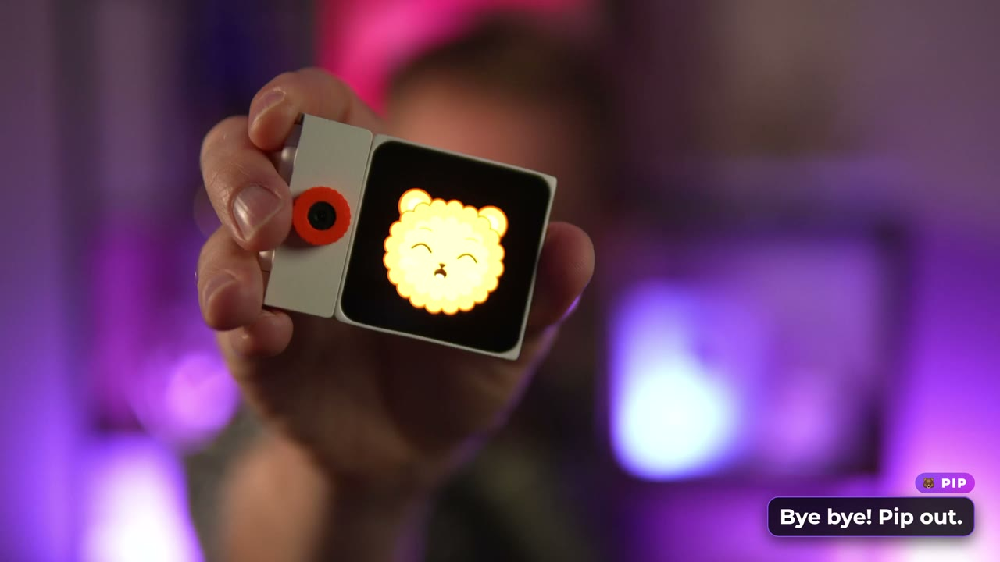

<p align="center">
  
</p>

<p align="center">
  <b>🎬 Watch the build:</b> <a href="https://youtu.be/7HAVLICDQXI">the full video on YouTube</a>
  &nbsp;·&nbsp;
  <b>🐟 Try Fish Audio:</b> <a href="https://mrc.fm/fishaudio">mrc.fm/fishaudio</a>
</p>

# Pip 🐻

**Pip is a tiny AI pet that lives on an ESP32.** It watches you through its camera, works out how
you're feeling, and talks to you in a voice that actually *acts*. Poke its face, pick it up, shake it,
turn it upside down, and Pip reacts like a small, dramatic, very lovable creature.

The voice is **[Fish Audio](https://mrc.fm/fishaudio) Drama 3**: every line Pip says comes with a stage
direction (`[gasps, then giggles]`, `[whispering, scandalised]`), so it's performed for the moment instead
of read out. The brain is **Claude**: it looks at the camera frame, reads your mood, and writes the line
and the direction. The body is an **ESP-Mosaico** tile from Espressif.

I built the whole thing by vibe coding with Claude Code, one prompt at a time. The exact prompts are in
[`prompts/STEP_BY_STEP.md`](prompts/STEP_BY_STEP.md).

<p align="center">
  
  
</p>
<p align="center">
  
  
</p>

## What Pip does

| You do this | Pip does this |
|---|---|
| 👆 Poke its face | Counts the pokes and gets more and more dramatic about it |
| 🤚 Press and hold | Melts into a happy, loved-up face |
| 🫴 Pick it up | "Whoa! Up we go, feet left the desk!" |
| 🌀 Shake it | Dizzy spiral eyes and a full theatrical meltdown |
| 🙃 Turn it upside down | Panics |
| 👆👆 Double tap | Tells you how your YouTube channel is doing (live views and subs) |
| 😀 / 😴 / 😠 Just sit there | Looks at you every few seconds and reacts to your mood: a grin gets a celebration, a slump gets a pep talk |
| 🚶 Walk away | Falls asleep, then wakes up happy when you come back |

## Meet the faces

Pip is drawn on the 480×480 screen as vector shapes (GSP SVG morphs), so it can blink, flap its mouth and
squash and stretch without filling the flash.

<p align="center">
  
</p>

The concept sketches for every character we considered (Mochi, Bolt, Pip, Boo, Mimi and the Firefly
round) are in [`design/faces/`](design/faces/).

## How it works

```
 ESP-Mosaico (Pip's body)                    Your computer (Pip's brain)   bridge/  Python + FastAPI
 ------------------------                    ---------------------------------------------------------
 face on screen (SVG morphs, 480x480)        POST /react?event=<name>     one call per reaction
 touch  -> poke | hold                          header X-Pet-Key, body = camera JPEG (optional)
 IMU    -> shake | pickup | flip | putdown           |
 camera -> look (every few seconds)          Claude (vision) reads your mood and writes
 timer  -> idle | stats                         {face, direction, line}
                                             Fish Audio Drama 3: "[direction] line"
 speaker <- raw PCM, streamed       <------  200: 16-bit mono 16 kHz PCM
 face    <- X-Face header                         + X-Face, X-Line headers
                                             YouTube Data API -> live views and subs
```

- **One request per reaction.** The device sends the event (and a fresh camera frame when it has one),
  the bridge streams the voice straight back and the face changes with it.
- **No API keys on the device.** Only Wi-Fi and the bridge address go onto the ESP32. Fish, Anthropic
  and YouTube keys stay in `.env` on your computer.
- **Repeats are instant.** Audio is cached by (model, voice, text).

## Build your own

### What you need

- An **ESP-Mosaico** tile with the **camera module** in the LEFT slot, on a solid USB-C 5 V supply
- A computer on the same network for the bridge (built on a Mac, Python 3.11+)
- API keys: **[Fish Audio](https://mrc.fm/fishaudio)**, **Anthropic**, and optionally **YouTube Data API v3**
- The ESP-Mosaico toolchain (ESP-IDF + `mosaico.py`) from Espressif

### 1. Keys

```sh
cp .env.example .env      # then fill it in
```

### 2. The brain (bridge)

```sh
cd bridge
python3 -m venv .venv && . .venv/bin/activate
pip install -r requirements.txt
python server.py          # listens on BRIDGE_PORT (8787)
```

Want to try voices first? `python audition.py` opens a little page that plays the same line in standard
TTS and in Drama 3 with different directions, so you can pick Pip's voice.

### 3. The body (firmware)

```sh
python scripts/gen_secrets.py     # writes firmware/main/secrets.h from .env (Wi-Fi + bridge only)
```

Then build and install `firmware/` as a project in the ESP-Mosaico workspace (`projects/drama_pet`) with
`mosaico.py`: simulate first, then `iris system-update` to the device. Details in
[`firmware/README.md`](firmware/README.md).

### 4. Poke it

Watch the bridge log (`python bridge/live_log.py` shows every turn: what Claude saw, the line, the
direction and the latency), and poke Pip.

## What's in here

| Path | What |
|---|---|
| `bridge/server.py` | The brain: Claude vision + Fish Audio Drama 3 + YouTube stats, one endpoint |
| `bridge/audition.py` | Voice audition page: standard TTS vs Drama 3, side by side |
| `bridge/live_log.py` | Live terminal view of every reaction |
| `bridge/fake_event.py` | Fire a reaction without the device |
| `firmware/` | ESP-Mosaico app: face UI, touch, IMU, camera, audio |
| `scripts/gen_secrets.py` | Generates the device's `secrets.h` from `.env` |
| `prompts/STEP_BY_STEP.md` | The whole build as Claude Code prompts, one per step |
| `AGENTS.md` | The rules file Claude Code worked from during the build (private paths removed) |
| `design/faces/` | Character concepts and the final expression sheet |

## Credits

Built by **Mike Russell** for **[Creator Magic](https://www.youtube.com/@CreatorMagicAI)**.
This project is sponsored by **[Fish Audio](https://mrc.fm/fishaudio)** (affiliate link).
ESP-Mosaico by Espressif. Brain by Claude (Anthropic).

<p align="center">
  
</p>

## Licence

[MIT](LICENSE)
